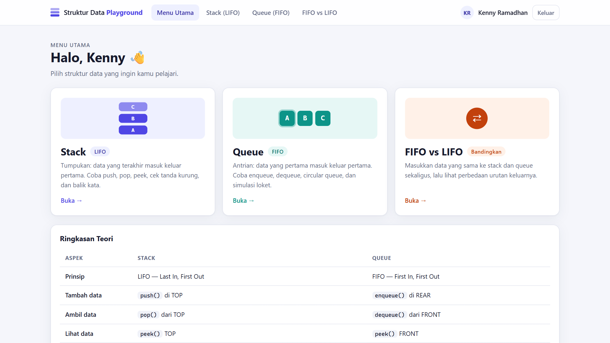
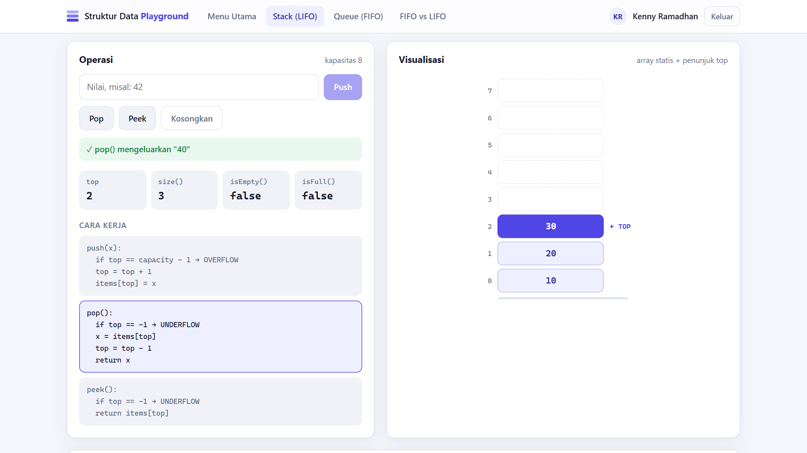
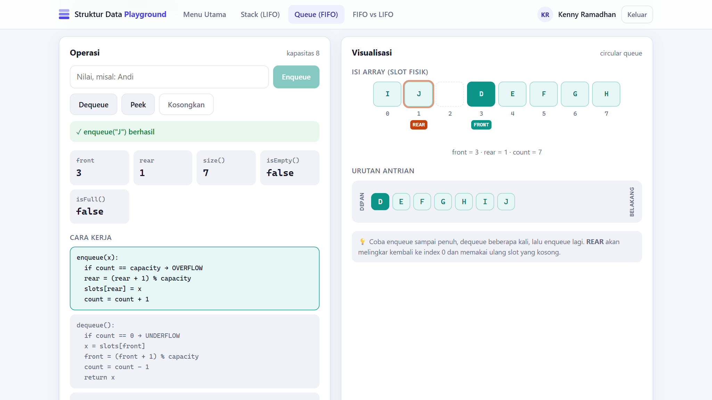
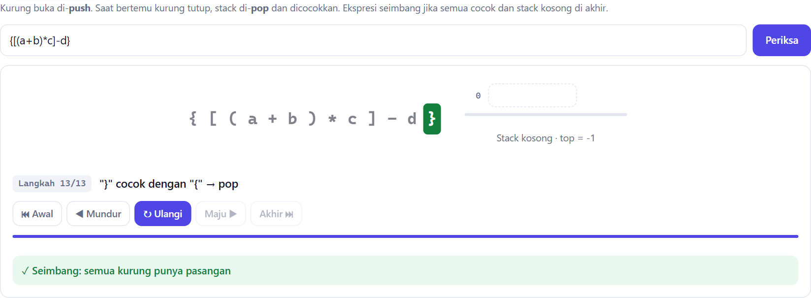
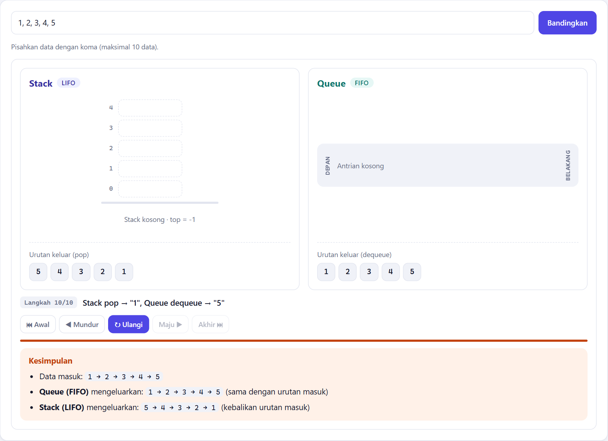

# Struktur Data Playground

Aplikasi web untuk memvisualisasikan struktur data **Stack (LIFO)** dan **Queue (FIFO)** secara interaktif.
Dibuat untuk tugas mata kuliah Struktur Data.

- **Frontend:** React (Vite)
- **Backend:** Node.js (Express)
- **Database:** SQLite (modul bawaan Node.js `node:sqlite`, tanpa instalasi tambahan)



## Dokumentasi

| Dokumen | Isi |
|---------|-----|
| [README](README.md) (halaman ini) | Ringkasan, cara menjalankan, fitur |
| [Teori Stack & Queue](docs/TEORI.md) | Konsep LIFO/FIFO, operasi, overflow/underflow, circular queue, kompleksitas, penerapan |
| [Panduan Penggunaan](docs/PANDUAN-PENGGUNAAN.md) | Cara memakai setiap halaman (dengan screenshot) dan skenario demo untuk presentasi |
| [Arsitektur & API](docs/ARSITEKTUR.md) | Arsitektur, alur request, skema database, referensi API, keamanan, pengujian, Docker |
| [**Laporan (PDF)**](docs/Laporan-Struktur-Data-Playground.pdf) | Laporan tugas lengkap: pendahuluan, teori, perancangan, hasil web dari login sampai semua menu, pengujian, penutup |

## Anggota Kelompok

| No | Nama | NIM | Username | Password |
|----|------|-----|----------|----------|
| 1 | Kenny Ramadhan | 312510195 | `312510195` | `312510195` |
| 2 | Ariq Firmansyah | 312510176 | `312510176` | `312510176` |
| 3 | Muhammad Ryno Al Faridz | 312510022 | `312510022` | `312510022` |
| 4 | Dwi Afandi | 312510100 | `312510100` | `312510100` |

> Hanya 4 akun di atas yang bisa login. Tidak ada fitur registrasi, dan database menolak penambahan user ke-5
> (lihat trigger `limit_users` di `server/src/db.js`). Daftar akun diatur di
> [`server/src/data/members.js`](server/src/data/members.js).

---

## Cara Menjalankan

Pilih **salah satu** cara berikut. Setelah berjalan, buka **http://localhost:3000** lalu login dengan salah satu akun di atas.

### Cara 1: Docker (disarankan)

Syarat: [Docker Desktop](https://www.docker.com/products/docker-desktop/) sudah terpasang dan berjalan.

```bash
docker compose up --build
```

Untuk menghentikan: tekan `Ctrl + C`, lalu `docker compose down`.

### Cara 2: Tanpa Docker (Node.js)

Syarat: **Node.js versi 22.13 atau lebih baru** (cek dengan `node -v`).

```bash
npm install     # meng-install dependency server & client sekaligus
npm start       # build frontend lalu menjalankan server
```

### Mode development (opsional)

```bash
npm run dev     # backend di :3000 + frontend (hot reload) di http://localhost:5173
npm test        # menjalankan unit test struktur data
```

---

## Fitur

| Menu | Isi |
|------|-----|
| **Login** | Autentikasi JWT, password disimpan sebagai hash bcrypt di SQLite |
| **Menu Utama** | Pilihan playground, ringkasan teori Stack vs Queue, daftar anggota kelompok |
| **Stack (LIFO)** | Operasi `push`, `pop`, `peek`, `clear`; visualisasi array + penunjuk `top`; deteksi overflow/underflow; pseudo-code operasi |
| ↳ Penerapan | **Cek tanda kurung seimbang** dan **balik kata**, dianimasikan langkah demi langkah |
| **Queue (FIFO)** | Operasi `enqueue`, `dequeue`, `peek`, `clear`; visualisasi **circular queue** dengan penunjuk `front` & `rear` |
| ↳ Penerapan | **Simulasi antrian loket**, dianimasikan langkah demi langkah |
| **FIFO vs LIFO** | Data yang sama dimasukkan ke stack & queue sekaligus, lalu urutan keluarnya dibandingkan |
| **Riwayat** | Setiap operasi (berhasil maupun gagal) dicatat ke tabel `operation_log` |

Isi stack dan queue disimpan **per user** di SQLite, jadi tidak hilang meskipun browser ditutup atau server di-restart.

### Tampilan

| Stack | Queue (circular) |
|-------|------------------|
|  |  |
| **Cek tanda kurung** | **FIFO vs LIFO** |
|  |  |

Panduan lengkap tiap halaman ada di [Panduan Penggunaan](docs/PANDUAN-PENGGUNAAN.md).

---

## Implementasi Struktur Data

Struktur data ditulis manual dalam bentuk class. **Tidak** memakai `Array.push()`/`Array.pop()` bawaan JavaScript.

| File | Keterangan |
|------|------------|
| [`server/src/ds/Stack.js`](server/src/ds/Stack.js) | Stack berbasis array statis berkapasitas tetap + penunjuk `top` |
| [`server/src/ds/Queue.js`](server/src/ds/Queue.js) | Circular queue: penunjuk `front`/`rear` melingkar dengan operasi modulo |
| [`server/src/algorithms/stackApps.js`](server/src/algorithms/stackApps.js) | Penerapan stack: cek tanda kurung & balik kata |
| [`server/src/algorithms/queueApps.js`](server/src/algorithms/queueApps.js) | Penerapan queue: simulasi antrian loket |
| [`server/src/algorithms/compare.js`](server/src/algorithms/compare.js) | Perbandingan FIFO vs LIFO |
| [`server/test/`](server/test) | Unit test (`npm test`) |

Kompleksitas waktu semua operasi (push, pop, enqueue, dequeue, peek) adalah **O(1)**.

### Alur sebuah operasi

```
React (klik "Push")
   → POST /api/stack/push        (dengan token JWT)
   → state dimuat dari SQLite    → Stack.fromJSON(...)
   → stack.push(nilai)           ← logika struktur data
   → state baru disimpan ke SQLite + dicatat di operation_log
   → respons JSON → React menggambar ulang visualisasi
```

---

## Struktur Folder

```
├── client/                 # Frontend React
│   └── src/
│       ├── pages/          # Login, Dashboard, StackPage, QueuePage, ComparePage
│       └── components/     # StackView, QueueView, StepPlayer, LogPanel, ...
├── server/                 # Backend Node.js
│   ├── src/
│   │   ├── ds/             # ★ Implementasi Stack & Queue
│   │   ├── algorithms/     # ★ Penerapan stack & queue
│   │   ├── routes/         # Endpoint API
│   │   ├── data/members.js # Daftar 4 anggota yang boleh login
│   │   └── db.js           # Skema SQLite & sinkronisasi user
│   └── test/               # Unit test
├── Dockerfile
└── docker-compose.yml
```

## Skema Database (SQLite)

| Tabel | Isi |
|-------|-----|
| `users` | 4 anggota kelompok (username, hash password, nama, NIM). Dibatasi maksimal 4 baris oleh trigger. |
| `ds_state` | Isi stack/queue terakhir milik tiap user (JSON) |
| `operation_log` | Riwayat semua operasi beserta status berhasil/gagal |

File database dibuat otomatis saat server pertama kali dijalankan: `server/data/app.db` (atau volume `app-data` jika memakai Docker).

## API

Semua endpoint selain `/api/auth/login` dan `/api/auth/team` membutuhkan header `Authorization: Bearer <token>`.

| Method | Endpoint | Keterangan |
|--------|----------|------------|
| POST | `/api/auth/login` | Login, mengembalikan token JWT |
| GET | `/api/auth/me` | Data user yang sedang login |
| GET | `/api/auth/team` | Nama-nama anggota (publik, untuk halaman login) |
| GET | `/api/auth/members` | Daftar anggota kelompok beserta NIM |
| GET | `/api/stack` | State stack + riwayat |
| POST | `/api/stack/push` · `/pop` · `/peek` · `/clear` | Operasi stack |
| GET | `/api/queue` | State queue + riwayat |
| POST | `/api/queue/enqueue` · `/dequeue` · `/peek` · `/clear` | Operasi queue |
| POST | `/api/demo/brackets` · `/reverse` · `/counter` · `/compare` | Demo penerapan (langkah-langkah) |

## Troubleshooting

- **Port 3000 sudah dipakai** (`port is already allocated` / `EADDRINUSE`):
  - Docker: jalankan dengan port lain, lalu buka `http://localhost:8080`.
    ```bash
    # macOS / Linux / Git Bash
    APP_PORT=8080 docker compose up --build
    # Windows PowerShell
    $env:APP_PORT=8080; docker compose up --build
    ```
  - Tanpa Docker: set environment variable `PORT` (misal `$env:PORT=8080` di PowerShell) sebelum `npm start`.
- **`No such built-in module: node:sqlite`:** versi Node.js terlalu lama. Perbarui ke Node.js 22.13+ atau gunakan Docker.
- **Ingin mengulang data dari awal:** hapus folder `server/data/` (tanpa Docker) atau jalankan `docker compose down -v` (Docker).
- **Login gagal setelah mengubah `members.js`:** restart server. Daftar user disinkronkan setiap kali server dijalankan.
