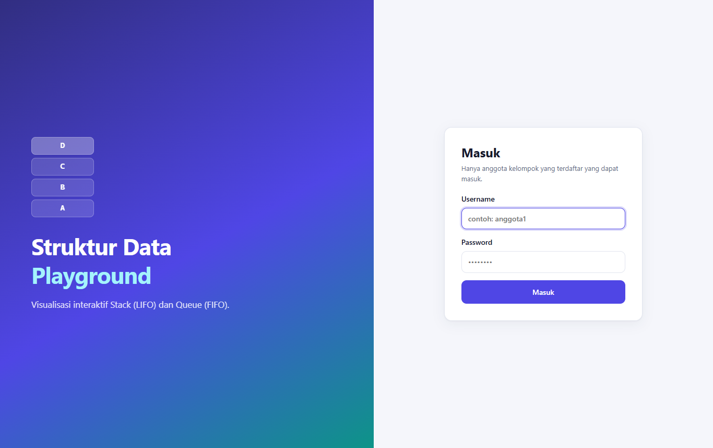
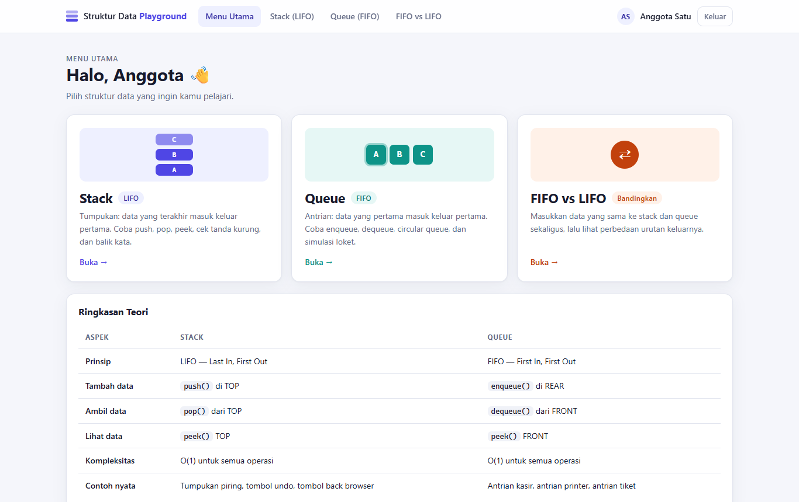
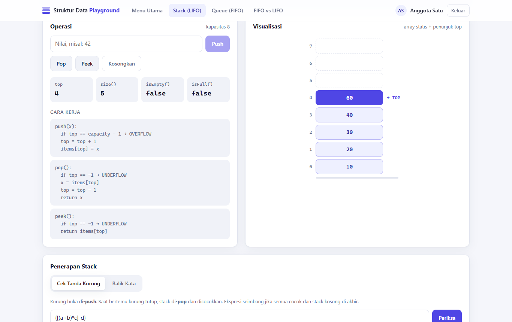
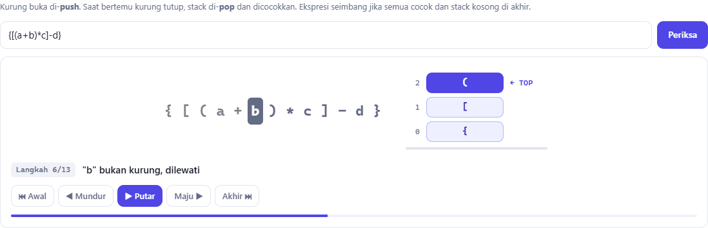
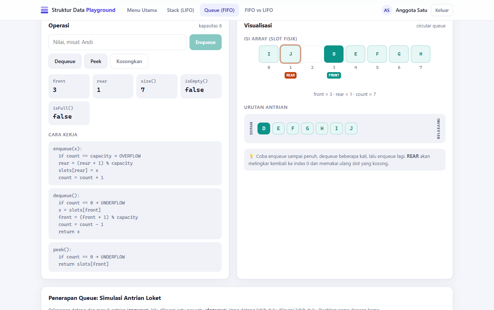
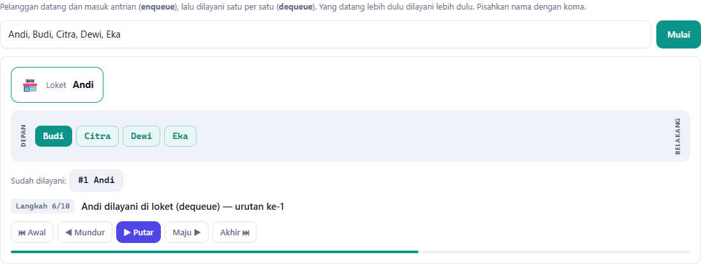
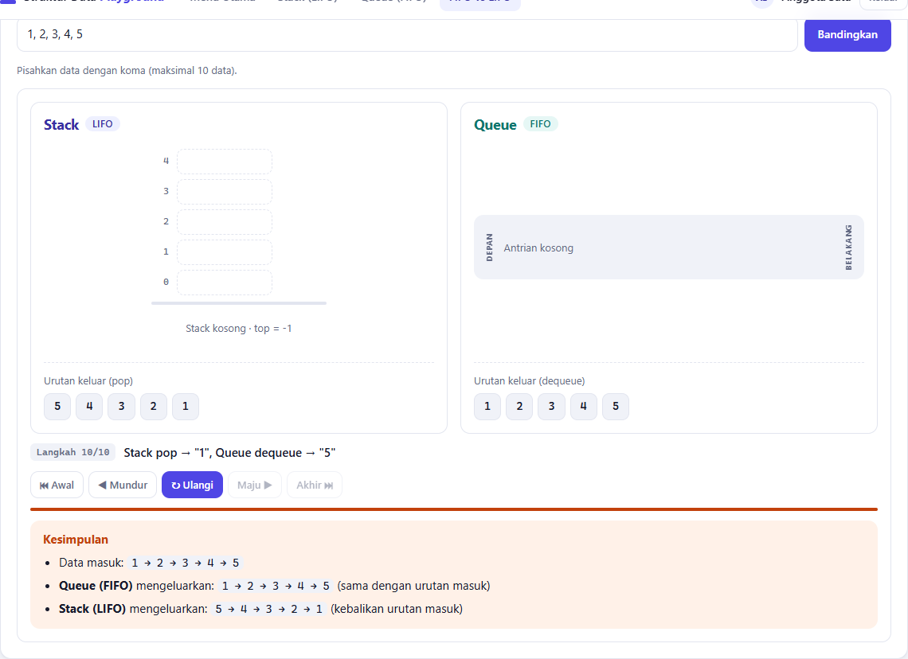

# Panduan Penggunaan

Panduan langkah demi langkah untuk memakai setiap fitur aplikasi. Untuk cara instalasi, lihat
[README](../README.md#cara-menjalankan).

## Daftar Isi

1. [Login](#1-login)
2. [Menu Utama](#2-menu-utama)
3. [Halaman Stack](#3-halaman-stack-lifo)
4. [Halaman Queue](#4-halaman-queue-fifo)
5. [Halaman FIFO vs LIFO](#5-halaman-fifo-vs-lifo)
6. [Pemutar Langkah (Step Player)](#6-pemutar-langkah-step-player)
7. [Skenario Demo untuk Presentasi](#7-skenario-demo-untuk-presentasi)

---

## 1. Login

1. Buka **http://localhost:3000**. Pengguna yang belum login otomatis diarahkan ke halaman login.
2. Masukkan **username** dan **password** salah satu anggota (lihat tabel di [README](../README.md#anggota-kelompok)).
3. Klik **Masuk**.

Catatan:

- Selain 4 akun anggota, login akan ditolak dengan pesan *"Username atau password salah"*.
- Sesi login berlaku **8 jam**. Setelah itu kamu perlu login ulang.
- Klik **Keluar** di pojok kanan atas untuk logout.

---

## 2. Menu Utama

Setelah login, Menu Utama menampilkan:

| Bagian | Isi |
|--------|-----|
| **Kartu menu** | Pintasan ke halaman Stack, Queue, dan FIFO vs LIFO |
| **Ringkasan Teori** | Tabel perbandingan Stack dan Queue |
| **Anggota Kelompok** | Daftar 4 anggota; akun yang sedang login ditandai **Kamu** |

Menu navigasi di bagian atas selalu tersedia di semua halaman.

---

## 3. Halaman Stack (LIFO)

### Panel Operasi

| Tombol | Fungsi |
|--------|--------|
| **Push** | Ketik nilai (maks. 12 karakter) lalu klik **Push** atau tekan Enter. Nilai masuk di posisi TOP. |
| **Pop** | Mengeluarkan nilai paling atas. |
| **Peek** | Melihat nilai paling atas tanpa mengeluarkannya. |
| **Kosongkan** | Menghapus seluruh isi stack. |

Di bawah tombol terdapat:

- **Pesan hasil:** hijau jika berhasil, merah jika gagal (overflow/underflow).
- **Statistik:** nilai `top`, `size()`, `isEmpty()`, `isFull()` saat ini.
- **Cara Kerja:** pseudo-code setiap operasi. Blok milik operasi terakhir diberi highlight.

### Panel Visualisasi

Stack digambar vertikal dengan **index 0 di bawah**. Elemen teratas berwarna penuh dan diberi label
**← TOP**. Slot bergaris putus-putus adalah slot kosong. Kapasitas stack adalah **8**.

### Mencoba overflow dan underflow

- **Overflow:** lakukan push 9 kali. Push ke-9 ditolak dengan pesan *"Stack penuh (overflow)"*.
- **Underflow:** kosongkan stack lalu klik Pop. Muncul pesan *"Stack kosong (underflow)"*.

### Penerapan Stack

| Tab | Cara pakai |
|-----|-----------|
| **Cek Tanda Kurung** | Tulis ekspresi, misal `{[(a+b)*c]-d}` atau `(a+b]`, lalu klik **Periksa**. Karakter yang sedang diproses diberi warna: biru = push, hijau = pop & cocok, merah = error, abu-abu = dilewati. |
| **Balik Kata** | Tulis kata, misal `STRUKTUR`, lalu klik **Balik**. Lihat huruf di-push satu per satu, kemudian di-pop untuk membentuk kata terbalik. |

### Riwayat Operasi

Daftar 15 operasi terakhir milik akunmu, diambil dari tabel `operation_log` di SQLite. Titik hijau berarti
berhasil, titik merah berarti gagal.

---

## 4. Halaman Queue (FIFO)

### Panel Operasi

| Tombol | Fungsi |
|--------|--------|
| **Enqueue** | Ketik nilai lalu klik **Enqueue** atau tekan Enter. Nilai masuk di posisi REAR (belakang). |
| **Dequeue** | Mengeluarkan nilai paling depan (FRONT). |
| **Peek** | Melihat nilai paling depan tanpa mengeluarkannya. |
| **Kosongkan** | Menghapus seluruh isi queue. |

Statistik yang ditampilkan: `front`, `rear`, `size()`, `isEmpty()`, `isFull()`.

### Panel Visualisasi

Ada dua tampilan:

1. **Isi array (slot fisik):** posisi asli data di dalam array berkapasitas 8. Label **FRONT** (hijau) dan
   **REAR** (oranye) menunjukkan posisi penunjuk.
2. **Urutan antrian:** urutan logis data dari depan ke belakang. Inilah urutan data akan keluar.

### Mencoba sifat melingkar (circular)

1. Enqueue 8 nilai, misal `A` sampai `H`. Queue penuh.
2. Dequeue 3 kali. `A`, `B`, `C` keluar dan slot 0–2 menjadi kosong.
3. Enqueue `I` lalu `J`.
4. Perhatikan **REAR melingkar kembali ke index 0 dan 1**, sementara FRONT berada di index 3. Urutan antrian
   tetap benar: `D, E, F, G, H, I, J`.

### Simulasi Antrian Loket

Tulis nama-nama pelanggan dipisah koma (maks. 10), misal `Andi, Budi, Citra, Dewi, Eka`, lalu klik
**Mulai**. Simulasi menampilkan pelanggan datang (enqueue), kemudian dilayani di loket satu per satu
(dequeue) sesuai urutan kedatangan.

---

## 5. Halaman FIFO vs LIFO

1. Tulis data dipisah koma (maks. 10), misal `1, 2, 3, 4, 5`.
2. Klik **Bandingkan**.
3. Simulasi berjalan dalam dua fase:
   - **Masuk:** setiap data di-push ke stack **dan** di-enqueue ke queue secara bersamaan.
   - **Keluar:** stack di-pop dan queue di-dequeue secara bersamaan.
4. Di langkah terakhir muncul **Kesimpulan**: queue mengeluarkan data sesuai urutan masuk, sedangkan stack
   mengeluarkan data dalam urutan terbalik.

---

## 6. Pemutar Langkah (Step Player)

Semua demo penerapan memakai pemutar langkah yang sama:

| Tombol | Fungsi |
|--------|--------|
| ⏮ **Awal** | Kembali ke langkah pertama |
| ◀ **Mundur** | Satu langkah ke belakang |
| ▶ **Putar** / ⏸ **Jeda** | Memutar otomatis atau menjeda |
| **Maju** ▶ | Satu langkah ke depan |
| **Akhir** ⏭ | Langsung ke langkah terakhir |
| ↻ **Ulangi** | Memutar ulang dari awal (muncul setelah selesai) |

Animasi berjalan otomatis saat demo dimulai. Penjelasan setiap langkah tampil di bawah visualisasi, dan
hasil akhir baru ditampilkan setelah langkah terakhir.

---

## 7. Skenario Demo untuk Presentasi

Urutan yang disarankan saat mendemokan aplikasi ke dosen (sekitar 5–7 menit):

1. **Login dibatasi.** Coba login dengan username asal → ditolak. Login dengan akun anggota → berhasil.
2. **Menu utama.** Tunjukkan ringkasan teori dan daftar anggota kelompok.
3. **Stack.** Push `10`, `20`, `30`, lalu Pop → keluar `30` (LIFO). Tunjukkan highlight pseudo-code dan
   perubahan `top`. Push sampai penuh untuk memperlihatkan **overflow**.
4. **Cek tanda kurung.** Jalankan `{[(a+b)*c]-d}` (seimbang), lalu `{[(a+b]*c)}` (tidak seimbang).
5. **Queue.** Enqueue `A`–`H` sampai penuh, dequeue 3 kali, lalu enqueue `I` dan `J`. Tunjukkan **REAR
   melingkar** ke index 0.
6. **Simulasi loket.** Jalankan dengan nama-nama anggota kelompok.
7. **FIFO vs LIFO.** Jalankan `1, 2, 3, 4, 5` dan tunjukkan kesimpulan urutan keluarnya.
8. **Persistensi.** Refresh halaman atau logout lalu login lagi. Isi stack/queue dan riwayat operasi masih
   ada karena tersimpan di SQLite.
9. **Kode.** Buka [`Stack.js`](../server/src/ds/Stack.js) dan [`Queue.js`](../server/src/ds/Queue.js),
   lalu jalankan `npm test` untuk menunjukkan unit test lulus.
